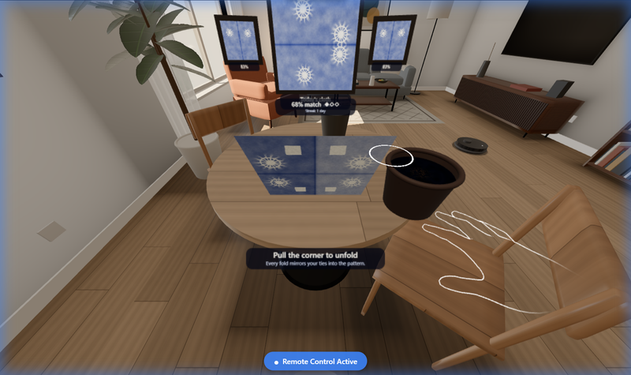
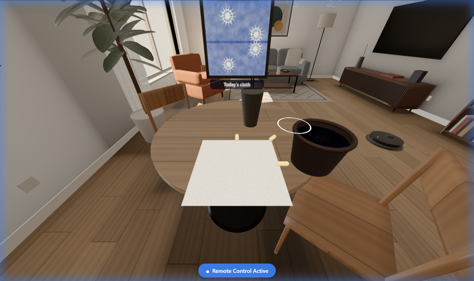
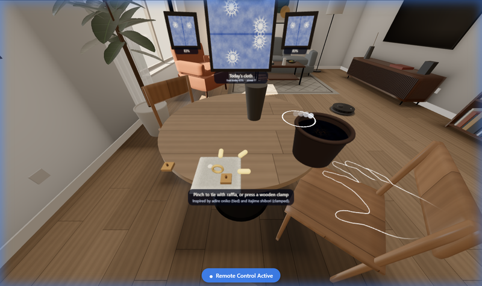
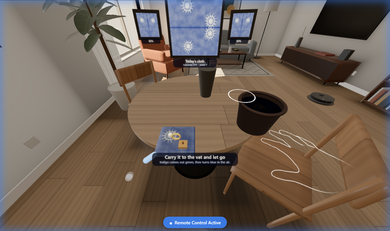

# Bluefold: fold, tie and dip cloth with bare hands, then unfold the indigo pattern you made

**Play:** https://owolabenjade.github.io/bluefold/ (open in the Meta Quest Browser) · **Video:** https://youtu.be/_0fn1PQe8d0 · Meta VR Start Developer Competition 2026, Gaming / New Experience



## What it does

- Turns the table in front of a seated player into an indigo resist-dye workshop. Bluefold finds the table with WebXR plane detection and lays a white cloth on it; if no table is found, it brings a small virtual one.
- Every step is done with bare hands: pinch an edge and fold the cloth around its crease, pinch the bundle to tie it with raffia, press a wooden clamp onto it, carry it by its loop to the vat, then pull a corner to unfold it.
- The pattern on the unfolded cloth is the one your folds and ties made. Each day brings a new target cloth to recreate; your result is scored against it, and your cloths collect in a gallery around it with a daily streak.

## Why it matters

Most VR games want standing room and controllers. Bluefold is built for a chair and a table: one cloth takes about two minutes, every interaction stays within arm's reach, and nothing needs a controller. It is a puzzle you can only solve with your hands, because the puzzle *is* what your hands do to the cloth.

Resist-dyeing is an old craft with a satisfying reveal: Yoruba *adire oniko* (cloth tied with raffia before dyeing) and Japanese *itajime shibori* (cloth folded and clamped between blocks). Bluefold is inspired by both. It is a simplified game model, not a simulation of either tradition.

## How it works

```
fold tabs (pinch, drag)   tie sheet (ray pinch)   clamp block (grab, drop)
          \                       |                       /
           v                      v                      v
                  recipe: folds[], ties[{x, z, kind, stage}], dips
                                  |
          +-----------------------+------------------------+
          v                                                v
  ClothMesh: folds the grid on the CPU          PatternBaker: GPU shader maps every
  (rotates each flap about its crease)          point of the flat cloth through the
                                                same folds, applies the resists at
                                                the stage they were made, inner
                                                layers take less dye
                                  |
                       render target -> cloth texture
                       64x64 dye maps -> similarity score vs today's cloth
```

1. [`src/bluefold/game.ts`](src/bluefold/game.ts) places the workspace on a detected horizontal plane (it prefers planes labelled `table`, nearest edge within reach) and runs the fold → tie → dip → unfold loop.
2. A fold is a line on the cloth. [`src/bluefold/fold.ts`](src/bluefold/fold.ts) reflects points across it (`mapThrough`), clips the bundle outline, and generates the daily target from a seeded random recipe.
3. While you hold a fold tab, the flap angle comes from where your hand is relative to the crease, so the cloth edge follows your hand.
4. [`src/bluefold/cloth.ts`](src/bluefold/cloth.ts) builds a grid with a centre vertex in every cell, so every half, quarter and diagonal crease runs along mesh edges.
5. [`src/bluefold/pattern.ts`](src/bluefold/pattern.ts) bakes the dye pattern: each tie or clamp is evaluated in the bundle space of the fold stage when it was made, which is why one tie on a twice-folded cloth becomes four mirrored sunbursts.
6. Dipping turns the cloth yellow-green; it oxidises to blue over three seconds, as real indigo does. More dips make it darker.
7. On unfold, both the result and today's target are baked to 64×64 dye maps and compared (mean absolute difference) to give the match score. Progress and the gallery are kept in `localStorage`.
8. All sounds are synthesised with Web Audio ([`src/bluefold/audio.ts`](src/bluefold/audio.ts)); the project ships no third-party art or audio.

## Built with Meta Immersive Web SDK

- **IWSDK 1.1.0** (WebXR, Three.js, ECS): `World`, systems and queries in [`game.ts`](src/bluefold/game.ts).
- **Hand tracking** with `OneHandGrabbable` near-grab (a pinch grabs) for the fold tabs, lift loop, clamp and unfold tab; `RayInteractable` pointer events for tying.
- **Scene understanding:** `XRPlane` entities (plane detection with semantic labels) to put the cloth on the real table; mixed reality passthrough session (`immersive-ar`).
- **Immersive Web Emulator (IWER)** and the IWSDK CLI to test and record every step without a headset.

## Proof

| Claim | Evidence |
|---|---|
| The full loop (fold, tie, clamp, dip, unfold, score) runs with hand input | Scripted hand runs in the Immersive Web Emulator, Quest 3 profile, synthetic living room ([ops/EVIDENCE.md](ops/EVIDENCE.md), E-003); screenshots below |
| The cloth is placed on a detected table plane | Emulator log `placed on plane -0.95 0.74 1.63` on the room's `table` plane (E-003) |
| The public build loads | GitHub Pages deploy and a console check in desktop Chrome (E-004) |

| Real table, before | Tied and clamped | Dyed |
|---|---|---|
|  |  |  |

## Try it

**On a Meta Quest 3 or 3S:**
1. Sit at a table with your controllers put down, and open https://owolabenjade.github.io/bluefold/ in the Quest Browser.
2. Press **Enter mixed reality** and allow spatial data, so Bluefold can find your table.
3. Pinch a glowing tab and fold. If you pause, a trail of dots shows the next move.

**Run locally:**

```sh
git clone https://github.com/Owolabenjade/bluefold.git
cd bluefold
npm ci
npm run dev        # managed browser with the Immersive Web Emulator
```

`npm run build` writes the static site to `dist/`. Node 22.12+ or 20.19+.

## What is real and what is not

- **Not yet tested on a headset.** Every step was built and verified in the Immersive Web Emulator (Quest 3 profile) with emulated hands and an emulated room. Real hand-tracking jitter, Quest Browser permissions and frame rate on device are unverified.
- Folds are rigid flat folds (half, quarter, diagonal), not a cloth simulation.
- The dye pattern is a stylised model (layer depth, crease darkening, tie and clamp resists), not a physical dye simulation.
- The score compares dye maps and is a game score, not a measure of craft.
- Progress is stored only in this browser (`localStorage`).

## Built during the competition

Started on 2026-11-17 for the Meta VR Start Developer Competition 2026 (New Experience). No code existed before. The project began from the `@iwsdk/create` starter; the starter's sample robot and scene were removed.

## What's next

- Test and tune on Quest 3 and 3S: grab radii, plane edge cases, frame budget.
- More techniques: accordion pleats, stitched resists, discharge patterns, multi-colour dips.
- Share a cloth as a recipe link, so friends can try to recreate yours.

## License

MIT. See [LICENSE](LICENSE).
